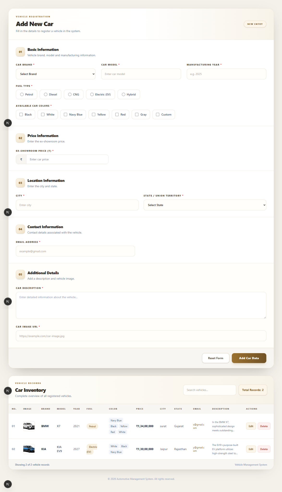

<div align="center">

# Automotive Management System


**A Modern Vehicle Registration and Inventory Management System**


</div>

---

## 📌 About The Project

Automotive Management System is a modern vehicle registration and inventory management interface designed to simplify vehicle record management.

It provides a structured form for registering new cars and an inventory table for viewing, searching, editing, and deleting vehicle records.

## 📸 Screenshots

### Vehicle Registration Form



## ✨ Features

### 1. Vehicle Registration

- Add new vehicle records.
- Select car brand and model.
- Enter manufacturing year.
- Choose fuel type.
- Select multiple vehicle colours.
- Enter ex-showroom price.
- Add city and state information.
- Enter contact email.
- Add vehicle description.
- Provide vehicle image URL.

### 2. Car Inventory

- Display all registered vehicles.
- Search vehicle records.
- View vehicle details.
- Edit existing records.
- Delete vehicle records.
- Display total vehicle count.
- Show vehicle images and pricing.

### 3. UI Design

- Premium light-theme interface.
- Clean and modern layout.
- Rounded input fields.
- Soft shadows and borders.
- Numbered form sections.
- Professional typography.
- Responsive-friendly design.
- Smooth hover animations.

## 🛠️ Tech Stack

| Technology | Purpose |
|---|---|
| React.js | Frontend |
| Tailwind CSS | Styling |
| JavaScript | Application logic |
| HTML5 | Structure |

## 📂 Project Structure

```text
automotive-management-system/
│
├── public/
│
├── src/
│   ├── components/
│   ├── App.jsx
│   ├── index.css
│   └── main.jsx
│
├── screenshots/
│   └── web.png
│
├── package.json
└── README.md
```

## ⚙️ Installation

### Step 1: Clone Repository

```bash
git clone YOUR_GITHUB_REPOSITORY_URL
```

### Step 2: Open Project Folder

```bash
cd automotive-management-system
```

### Step 3: Install Dependencies

```bash
npm install
```

### Step 4: Start Development Server

```bash
npm run dev
```

### Step 5: Open Application

Open the local URL displayed in your terminal.

## 🚗 Fuel Types Supported

- Petrol
- Diesel
- CNG
- Electric (EV)
- Hybrid

## 🎨 Available Vehicle Colours

- Black
- White
- Navy Blue
- Yellow
- Red
- Gray
- Custom

## 📋 Vehicle Information

| Field | Description |
|---|---|
| Brand | Vehicle manufacturer |
| Model | Vehicle model |
| Year | Manufacturing year |
| Fuel | Fuel category |
| Colour | Available colours |
| Price | Ex-showroom price |
| City | Registration city |
| State | Registration state |
| Email | Contact email |
| Description | Vehicle details |

## 🚀 Future Improvements

- Dashboard analytics.
- Advanced inventory filters.
- Vehicle image preview.
- Export records to Excel.
- Advanced search and sorting.
- Database integration.
- Authentication system.
- Improved mobile responsiveness.

## 👨‍💻 Developer

**Automotive Management System**

Developed using React.js and Tailwind CSS.

---

<div align="center">

**Made with React & Tailwind CSS**

© 2026 Automotive Management System

</div>
