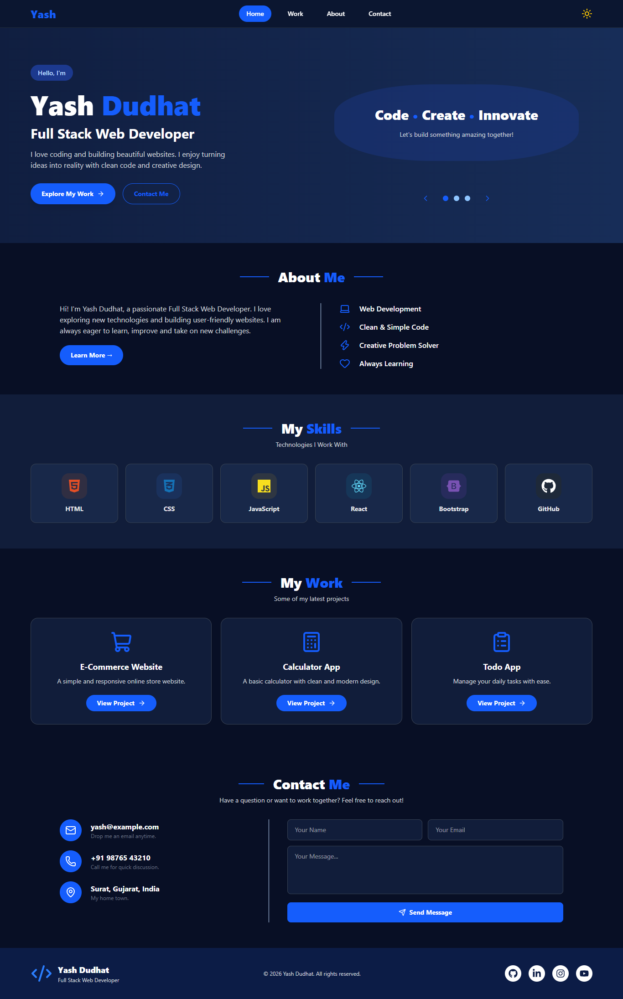
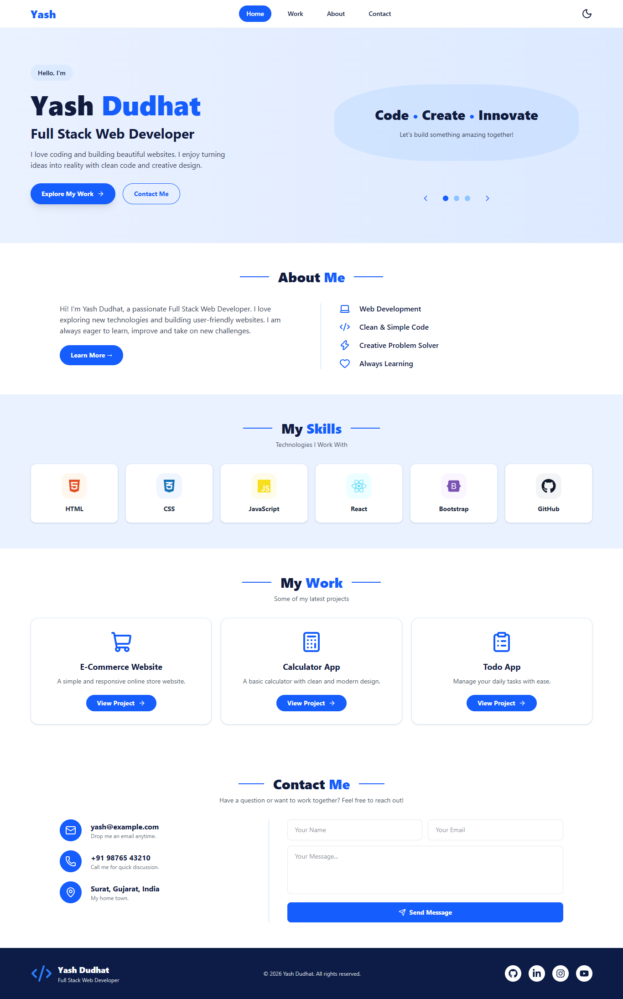

<!-- YASH DUDHHAT - ANIMATED PORTFOLIO README -->

<div align="center">


<p>
  
  
  
</p>

**A modern, responsive personal portfolio website.**

[Preview](#-preview) •
[Features](#-features) •
[Tech Stack](#-tech-stack) •
[Installation](#-installation) •
[Contact](#-contact)

</div>

---

## 🚀 About The Project

A modern personal portfolio website designed for **Yash Dudhhat**.

The website showcases my development skills, projects, technologies, and contact information with a clean UI and interactive elements.

## 🖥️ Preview

<table>
<tr>
<td align="center"><b>Dark Theme</b></td>
<td align="center"><b>Light Theme</b></td>
</tr>
<tr>
<td>

</td>
<td>

</td>
</tr>
</table>

## ✨ Features

- Responsive navigation bar
- Modern hero section
- Animated hero slider
- Smooth navigation
- About Me section
- Skills showcase
- Project cards
- Contact form UI
- Dark and Light mode
- Interactive buttons
- Modern blue UI design
- Responsive layout
- Animated GitHub README

## 🛠️ Tech Stack

| Technology | Purpose |
|---|---|
| React | Frontend |
| Vite | Development environment |
| JavaScript | Functionality |
| CSS | Styling and animations |
| Lucide React | Icons |

## 💻 Skills

<div align="center">


</div>

## 📂 Project Structure

```text
portfolio/
│
├── public/
│
├── docs/
│   └── screenshots/
│       ├── dark.png
│       └── light.png
│
├── src/
│   ├── assets/
│   ├── components/
│   ├── App.jsx
│   ├── main.jsx
│   └── index.css
│
├── index.html
├── package.json
└── README.md
```

## ⚡ Installation

### 1. Clone Repository

```bash
git clone https://github.com/YashDudhat55
```

### 2. Open Project

```bash
cd https://github.com/YashDudhat55
```

### 3. Install Dependencies

```bash
npm install
```

### 4. Run Development Server

```bash
npm run dev
```

Open:

```text
http://localhost:5173
```

## 🏗️ Production Build

```bash
npm run build
```

Preview:

```bash
npm run preview
```

## 🎯 My Projects

<div align="center">

| Project | Description |
|---|---|
| 🛒 E-Commerce Website | Online shopping interface |
| 🧮 Calculator App | Modern calculator |
| 📋 Todo App | Daily task management |

</div>

## 🎨 Customization

You can customize:

- Personal information
- Profile description
- Skills and technologies
- Project details
- Contact information
- Social media links
- Website themes
- Colors and animations


## 📬 Contact

<div align="center">

**Yash Dudhhat**

Full Stack Web Developer

<a href="https://github.com/YOUR_USERNAME">

</a>

<a href="https://www.linkedin.com/in/YOUR_LINKEDIN">

</a>

<a href="mailto:YOUR_EMAIL">

</a>

</div>

---

<div align="center">


### Code • Create • Innovate

**Designed & Developed by Yash Dudhhat**

</div>


