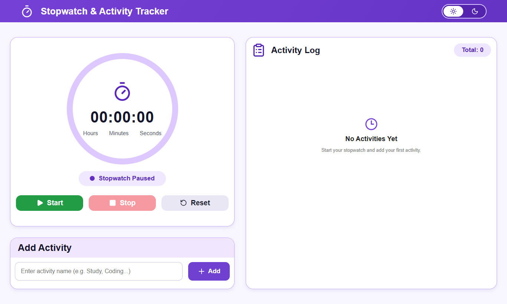
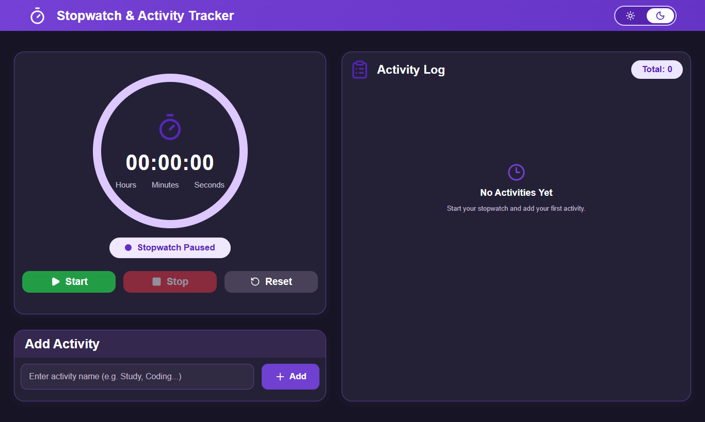

<div align="center">


<br/>


### A Collection of My React.js Projects

*Exploring React, building applications, and improving frontend development skills.*

[Main Repository](https://github.com/YashDudhat55/React-JS) • [Stopwatch Project](https://github.com/YashDudhat55/React-JS/tree/main/stop-watch-app)

</div>

---

## 👨‍💻 About This Repository

Welcome to my **React-JS Repository!**

This repository contains my React.js projects, experiments, and practical implementations created while learning frontend development.

Each project focuses on improving my understanding of React components, JavaScript, UI design, state management, and responsive web development.

## 🚀 Featured Project

### ⏱️ Stopwatch & Activity Tracker

A modern stopwatch application built using React with a clean dashboard interface.

<div align="center">

### ☀️ Light Mode



### 🌙 Dark Mode



</div>

### ✨ Features

- Start, Stop and Reset stopwatch.
- Live hours, minutes and seconds display.
- Add custom activities.
- Activity Log dashboard.
- Light and Dark theme switch.
- Modern purple-themed interface.
- Responsive dashboard layout.

### 🛠️ Technologies Used

- React.js
- JavaScript
- CSS3
- Lucide React (if installed)
  
---

## 🧰 Tech Stack

<div align="center">


</div>

---

## 📂 Repository Structure

```text
React-JS/
│
├── stop-watch-app/
│   ├── src/
│   ├── public/
│   ├── screenshots/
│   │   ├── light-mode.png
│   │   └── dark-mode.png
│   ├── package.json
│   └── README.md
│
└── README.md
```

*Folder structure may vary as more projects are added.*

---

## 💻 Installation & Setup

### 1. Clone Repository

```bash
git clone https://github.com/YashDudhat55/React-JS.git
```

### 2. Open Project Folder

```bash
cd React-JS
```

### 3. Enter Stopwatch Project

```bash
cd stop-watch-app
```

### 4. Install Dependencies

```bash
npm install
```

### 5. Run Development Server

```bash
npm run dev
```

Open the localhost URL displayed in your terminal.

---

## 🎯 Learning Goals

- Learn React.js fundamentals.
- Understand Components and JSX.
- Practise Props and State.
- Work with React Hooks.
- Build reusable components.
- Improve UI/UX design.
- Create responsive applications.
- Improve JavaScript programming skills.

---

## 🌟 More Projects Coming Soon

This repository will continue growing with new React applications, experiments, and frontend projects.

Stay tuned for more updates!

---

## 🤝 Connect & Explore

<div align="center">

<a href="https://github.com/YashDudhat55">

</a>

<br/><br/>

<a href="https://github.com/YashDudhat55/React-JS">

</a>

</div>

---

<div align="center">

### Thanks for Visiting!


</div>
